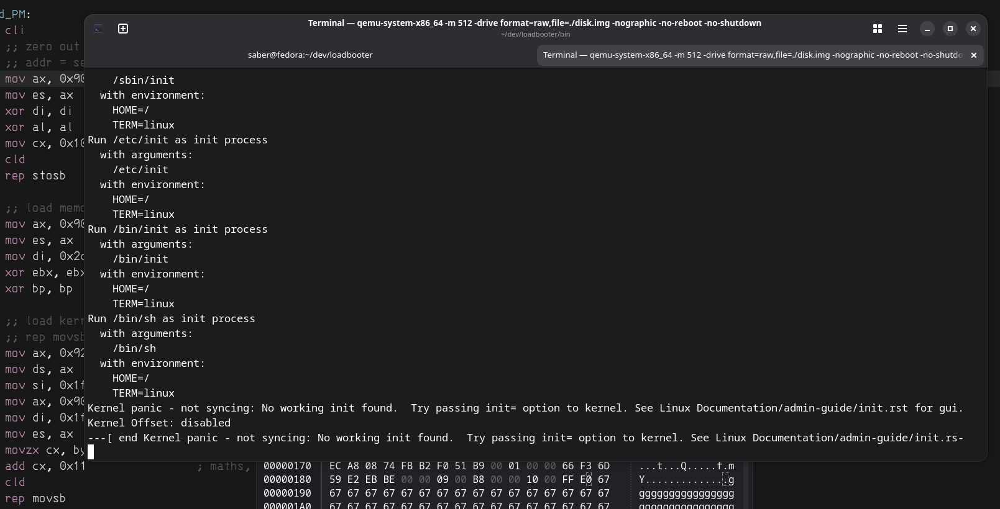

# loadbooter-v1
A tiny bootloader written for learning purposes.

A few things are hardcoded, use the pre-compiled bzImage for it to work properly.

Run with
```
cd bin/ && qemu-system-x86_64 -m 512 -drive format=raw,file=./disk.img -nographic -no-reboot -no-shutdown
```
